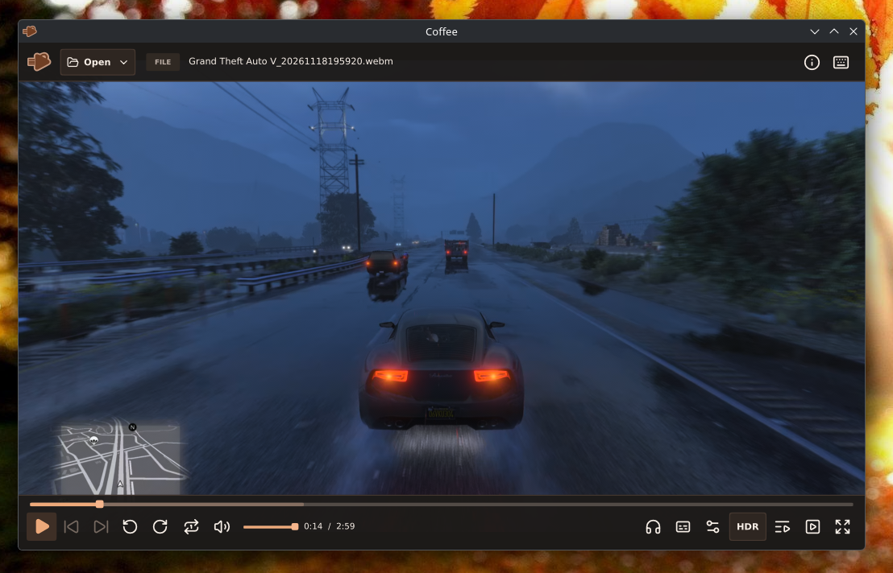

  
  <h1 align="center" style="display:inline">Coffee</h1>

  <strong>Coffee is a native Rust player for video, music, and photos, using libmpv and FFmpeg.</strong> 

  
  
  
  

## Download

**Coffee 1.6** · [Latest release](https://github.com/arazgray/coffee/releases/latest) · [SHA-256 checksums](https://github.com/arazgray/coffee/releases/download/v1.6/SHA256SUMS.txt)

| OS | Architecture |
| --- | --- |
| Linux — Ubuntu, Kubuntu, Debian (`.deb`) | [x86-64](https://github.com/arazgray/coffee/releases/download/v1.6/coffee-1.6.0-amd64.deb) · [ARM64](https://github.com/arazgray/coffee/releases/download/v1.6/coffee-1.6.0-arm64.deb) |
| Linux — Fedora (`.rpm`) | [x86-64](https://github.com/arazgray/coffee/releases/download/v1.6/coffee-media-player-1.6.0-1.x86_64.rpm) · [ARM64](https://github.com/arazgray/coffee/releases/download/v1.6/coffee-media-player-1.6.0-1.aarch64.rpm) |
| Linux — Arch and other distributions (`.tar.gz`) | [x86-64](https://github.com/arazgray/coffee/releases/download/v1.6/coffee-1.6.0-linux-x86_64.tar.gz) · [ARM64](https://github.com/arazgray/coffee/releases/download/v1.6/coffee-1.6.0-linux-aarch64.tar.gz) |
| macOS (`.zip`) | [Apple Silicon (ARM64)](https://github.com/arazgray/coffee/releases/download/v1.6/coffee-1.6.0-macos-arm64.zip) · [Intel (x86-64)](https://github.com/arazgray/coffee/releases/download/v1.6/coffee-1.6.0-macos-x86_64.zip) |
| Windows (`.zip`) | [x64](https://github.com/arazgray/coffee/releases/download/v1.6/coffee-1.6.0-windows-x86_64.zip) |

## Install

Coffee requires **libmpv 0.41 or newer**.

- **Ubuntu, Kubuntu, and Debian-based systems:** use the `.deb` on a release that provides libmpv 0.41 or newer. Older stock repositories may not supply a new enough version.
- **Fedora:** use the `.rpm` on Fedora 44 or newer. **Arch and other Linux distributions:** use the Linux `.tar.gz` with your distribution's libmpv, KDialog, and `xdg-utils`. The archive contains `bin/` and `share/` directories that can be installed under a user or system prefix.
- **Windows x64:** unzip the Windows archive. Install [MSYS2](https://www.msys2.org/) and run `pacman -S mingw-w64-ucrt-x86_64-mpv mingw-w64-ucrt-x86_64-libheif` in its **UCRT64** terminal. Launch `Coffee.exe`. Coffee looks for MSYS2 under `C:\msys64` by default, or under `MSYS2_ROOT` if set.
- **macOS (Apple Silicon and Intel):** run `brew install --cask arazgray/tap/coffee` to install Coffee and its dependencies from the [project’s Homebrew tap](https://github.com/arazgray/homebrew-tap). For a manual install, run `brew install mpv libheif ffmpeg` and extract the zip for your CPU. The app is not notarized, so macOS may block it on first launch.

To build from source, install Rust and run `cargo test --locked` and `cargo build --release --locked`. On Linux, `sh install.sh` installs the result for the current user. `coffee --smoke-test path/to/media` checks opening and decoding a file without creating a player window. `COFFEE_LIBMPV` can point to a different libmpv installation.

**Smooth Playback** needs the FFmpeg command-line program with `libx264` and `zscale` for the software path. Seek thumbnails also use this executable. Install `ffmpeg` from your Linux package manager, `brew install ffmpeg` on macOS, or `pacman -S mingw-w64-ucrt-x86_64-ffmpeg` in MSYS2 **UCRT64** on Windows. Set `COFFEE_FFMPEG` to use a different executable. On Linux, the subtitle font picker uses `fc-list` from the `fontconfig` package.

## Playback

- Drop media on the window to add it to the queue and play the first dropped item. **Open → Add files to queue** appends without interrupting playback.
- **Repeat One**, just before the volume button, loops the current video or song without advancing the queue. Click it again to turn it off.
- The **gear icon** opens playback settings, including HDR, decoder, and rendering. Use **−** and **+** around the current speed to step down or up from **1.0×**. The range is **−64×** (reverse) to **64×** (forward). Reverse is available for seekable media and uses software decoding for video. Some formats play more slowly in reverse, and embedded subtitles may not show.
- Hover over the seek bar to see the timestamp and a thumbnail. Coffee builds a small thumbnail index in the background when you open a local video, so previews update as you move. An uncached area may take a moment on first hover. Hovering does not seek. Thumbnails use FFmpeg; seekable streams or unavailable frames show the timestamp without a thumbnail.
- Open a photo to browse nearby images with **Previous** and **Next**. Photos switch without a fade or hiding the controls. Coffee preloads five photos on each side and their Live clips in the background, prioritizing the current Live clip. The RAM cache is bounded at 256 MiB (128 MiB per file); uncached files still open normally.
- A same-named `.MOV` companion adds a **Live** badge. Click it to play the clip and automatically return to the still without adding a playlist item. Live Photo transitions blend directly into the next frame over 150 ms.
- **Slideshow**, beside **Live** in the playback area, opens a dropdown with optional music and a **Play** button. Play enters fullscreen and crossfades to the next photo every five seconds, looping through the folder. Move the mouse to reveal the hidden controls, or press **Esc** to stop the slideshow and its music.
- The photo bar has **Fit** (show the entire image), **Fill** (crop to fill the window), and **100%** (one image pixel per display pixel). Drag across the photo to pan along any cropped axis. The selected zoom carries over to the next photo.
- **Open Streams** uses the player's own dark URL dialog. It accepts HLS, DASH, and direct HTTP(S) URLs. Paste with **Ctrl+V** (or **Command+V** where supported).
- The **Subtitles** panel has an **LTR | RTL** switch for text captions. Select the active direction again to return to the track’s default rendering. Forced direction uses plain text with the same subtitle font, size, and outline; it does not alter image-based subtitles. Use **Font** to search installed system fonts and choose one for text subtitles, or select **System default** to reset. Coffee remembers your choice. The **Encoding** dropdown can reload an external text track with UTF-8, Windows-1256 (Arabic), or another common encoding. Subtitles move above the playback bar when it appears.
- The playlist supports `.coffee.json` and older `.kahve.json` files, plus `.m3u`/`.m3u8` import. Playlists refer to local paths and URLs; they don't copy media.
- Double-click a photo or video to toggle fullscreen. Double-click open space on either control bar to maximize or restore. Right-click for playback actions and the current item's containing folder or playlist entry.
- The player and stream dialog are always dark. On KDE Plasma 6, Coffee adds a dark window-frame rule scoped to `coffee`. Other Linux compositors may control their own decorations. Coffee requests a dark frame on Windows and macOS.

## Smooth Playback

When a local video keeps dropping frames or falling behind, Coffee reveals **Smooth Playback** in the upper-right corner (where **Live** appears for photos). It stays available for that video once detected. Click **Start** in the panel to pause the original and make a reusable H.264 video track at up to 1080p, keeping the frame rate and converting HDR to SDR. The panel shows progress and an ETA; you can close the panel without stopping the job or click **Cancel** to discard the partial copy. Switching to another item also cancels preparation.

The prepared MP4 is saved beside its source, using the source’s name with `-coffee` added: `Holiday.mov` becomes `Holiday-coffee.mp4`. Coffee adds a number if necessary to avoid overwriting an existing file. The source folder must be writable to make a new copy. If a prepared copy from Coffee 1.1 or earlier is still in the old cache, **Save copy** saves it beside the original without re-encoding it.

Select **Play prepared** to use the saved video track, or **Use original** to switch back. The MP4 itself is video-only; during playback Coffee keeps the original audio, subtitles, and playlist entry. On Linux, Coffee tries Vulkan processing and VA-API encoding when supported, and falls back to CPU conversion if needed. Coffee reuses a prepared MP4 that matches the current original.

## Supported media

Coffee uses the demuxers and decoders in its installed libmpv/FFmpeg build. The lists below cover Coffee’s media filters and commonly supported codecs. Use **All files** for other extensions. Container support does not guarantee support for every codec or profile inside it; hardware decoding also depends on the GPU and driver. See FFmpeg’s [full format and codec reference](https://ffmpeg.org/general.html#Supported-File-Formats_002c-Codecs-or-Features) for the broader list.

### Video

| Format / container | Extensions |
| --- | --- |
| MPEG-4 / QuickTime | `.mp4`, `.m4v`, `.mov`, `.qt`, `.3gp`, `.3g2` |
| Matroska / WebM / Ogg | `.mkv`, `.webm`, `.ogv` |
| Audio Video Interleave | `.avi` |
| MPEG video and program streams / DVD | `.mpeg`, `.mpg`, `.m1v`, `.m2v`, `.vob` |
| MPEG transport streams / AVCHD | `.ts`, `.m2t`, `.m2ts`, `.mts` |
| Windows Media / ASF and Flash Video | `.wmv`, `.asf`, `.flv`, `.f4v` |
| Broadcast and legacy formats | `.mxf`, `.dv`, `.rm`, `.rmvb`, `.nut` |

**Video codecs:** H.264/AVC, H.265/HEVC, AV1, VP9, VP8, VP6, MPEG-1 Video, MPEG-2 Video, MPEG-4 Part 2 (including DivX/Xvid), H.261, H.263, Theora, VC-1, WMV7/8/9, Sorenson, RealVideo, Motion JPEG, DV, Apple ProRes, DNxHD/DNxHR, FFV1, CineForm, HuffYUV, UT Video, Hap, and raw/uncompressed video. Newer or optional decoders such as H.266/VVC depend on the bundled FFmpeg version and build options.

**Streams:** HLS (`.m3u8`), MPEG-DASH (`.mpd`), and direct HTTP(S) media URLs.

### Photos

- **JPEG** `.jpg`, `.jpeg`, `.jfif`, `.jpe`; **PNG/APNG** `.png`, `.apng`; **GIF** `.gif`; **WebP** `.webp` (lossy, lossless, transparency, and animation).
- **AVIF** `.avif`; **HEIC/HEIF** `.heic`, `.heif`, `.heics`, `.heifs`; **JPEG XL** `.jxl`; **JPEG 2000** `.jp2`, `.j2k`, `.j2c`; **QOI** `.qoi`.
- **TIFF** `.tif`, `.tiff`; **BMP** `.bmp`; **ICO** `.ico`; **Targa** `.tga`; **DDS** `.dds`; **Radiance HDR** `.hdr`; **OpenEXR** `.exr`; **Netpbm** `.pbm`, `.pgm`, `.ppm`, `.pam`.

Full-resolution tiled HEIC/HEIF (common on iPhones) uses libheif with an HEVC decoder. The Debian package recommends `libheif-plugin-libde265`; Fedora users may need `libheif-freeworld` from RPM Fusion. Local animated WebP works on older FFmpeg builds too. Experimental WebP v2 is not supported.

### Music

| Format / codec | Extensions |
| --- | --- |
| MPEG audio layers II and III | `.mp2`, `.mp3` |
| AAC (including AAC-LC / HE-AAC) | `.aac`, `.adts`, `.m4a`, `.m4b` |
| Apple Lossless | `.alac`, `.m4a`, `.m4b`, `.caf` |
| Lossless audio (FLAC, Monkey’s Audio, WavPack, True Audio) | `.flac`, `.ape`, `.wv`, `.tta` |
| PCM and other audio in WAV, AIFF, CAF and AU | `.wav`, `.wave`, `.aif`, `.aiff`, `.aifc`, `.caf`, `.au` |
| Vorbis and Opus | `.ogg`, `.oga`, `.opus` (also `.webm`, `.mka`) |
| Windows Media Audio | `.wma`, `.asf` |
| Dolby Digital / Digital Plus, DTS, and AMR | `.ac3`, `.eac3`, `.dts`, `.amr` |
| Matroska Audio | `.mka` |

Many of the same audio codecs also play as tracks inside video containers, including AAC, AC-3, E-AC-3, DTS, TrueHD, FLAC, Opus, Vorbis, and PCM. Audio passthrough and multi-channel output depend on the audio hardware and system configuration.

## HDR and hardware decoding

Coffee uses libmpv's `gpu-next` renderer. On Wayland it tries Vulkan first, keeping video on the native renderer and the controls in an SDR overlay. **Playback** contains **Off (SDR only)**, **Automatic HDR**, **Prefer native HDR**, **Video decoder**, and **Rendering quality**.

**Video info** shows the actual decoder, display target, and dropped frames. Choosing a GPU cannot accelerate a codec that it does not support. The default rendering mode switches to lighter scaling and static tone mapping for 4K at 50 fps or above. HDR presentation still depends on the GPU, driver, and display.

## Artwork and license

Coffee is licensed under [MIT](LICENSE). The bundled [Lucide](assets/LUCIDE-LICENSE) assets are converted to SDR vector paths at build time. `tools/sync-icons.mjs` refreshes them with `lucide` 1.80 installed; `tools/sync-logo.sh` refreshes the logo with ImageMagick and Potrace. Neither is needed to build or run from bundled assets.
